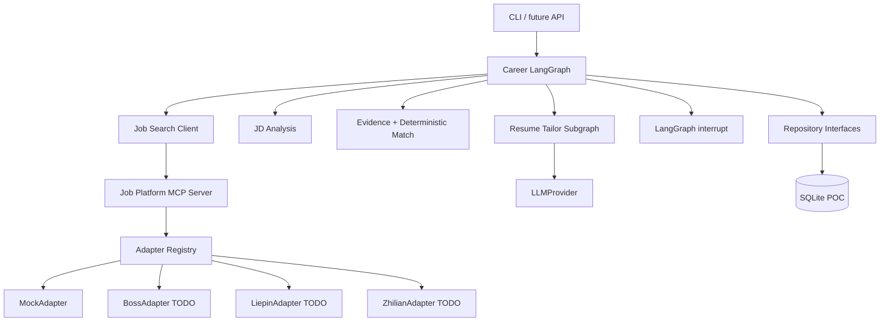

# Career Agent POC 实施计划

## 0. 文档状态与实施边界

- 本文是当前仓库的实现基线；产品规格已由用户确认，不再做低代码平台迁移或需求再发散。
- 请求分类：`request_type=new_feature`，`change_tier=standard`，`feature_path=career-agent-poc`，`feature=Career Agent POC`，`feature_level=1`。
- 目标运行时：Python 3.12+、Pydantic v2、LangGraph、async/await、pytest。
- 架构形态：**modular monolith**。业务能力位于一个可安装的 `career_agent` 包内；唯一独立协议边界是 Job Platform MCP Server。Resume Tailor、JD Parser、Evidence Matcher 等不是 MCP 服务。
- 当前已完成 Phase 1–4：domain models、Resume/JD facts、Resume Tailor subgraph，以及 Persistence/Career graph；后续仍按阶段创建真实实现，不预建空壳。
- POC 不做真实自动投递；Human Approval 通过后只持久化 `READY_TO_APPLY`。

## 1. 仓库与 legacy 审计

### 1.1 当前状态

仓库当前没有 Python 工程、依赖清单或测试；只有两个腾讯平台导出包：

1. `上海工商学院智能求职助手_v20260910222638_package/...`
2. 其中嵌套的 `智能简历优化助手_v20260910144208_package/...`

导出包包含平台 Agent/Workflow/Skill/知识库配置，不是可以增量维护的高代码 Python 项目。新实现不会复刻平台专用 ID、Widget、Prompt 路由、知识库配置、浏览器脚本或工作流 JSON。

### 1.2 可复用的业务规则

以下规则进入新系统的 domain invariant、validator 和测试，而不是原样复制长 Prompt：

- 字段状态明确区分 `confirmed / unknown / none / unsure / withheld / conflict`；“没有”“不知道”“暂不提供”“信息冲突”不能混为一类。
- JD 必须拆为原子要求；硬条件、核心职责与技能分别核对，JD 未写明的条件是未知，不能默认为满足。
- 简历证据保留用户原文/附件原文；事实台账记录时间、角色、行动、对象/工具、产物或真实反馈及来源。
- 经历表达优先采用“行动 + 对象/已知工具或方法 + 产物/真实反馈”，允许同义改写、排序、合并，不允许增加事实数量。
- “参与”不能升级成“主导”；课程项目必须标为课程项目，能证明能力但不能折算正式工作年限；AI 辅助不能改写为独立研发。
- 缺少数字时不强行量化，改写为真实行动、交付物、参与环节或定性反馈；没有这些就保持简短。
- 学生未提到的技能属于 `UNKNOWN`，不等于 `NO_MATCH`；未知事实不能成为正向匹配证据。
- 岗位详情、薪资口径、来源链接与采集时间应保留原文；不能用搜索摘要补写缺失 JD。

### 1.3 明确拒绝复用的内容

旧导出中的“生成学生项目”“编项目”“补职责”“补技术场景”等许可，与本 POC 的强事实边界冲突，**不迁移**。即使它将虚构限定为学生项目或定性成果，本系统仍不得把未出现在 Master Resume、用户补充或其他可引用来源中的内容写入 Tailored Resume。

同样拒绝：

- 用 JD 要求、兴趣测评、岗位常识或模型猜测反推候选人能力；
- 自动补公司、客户、职责、工具、熟练度、规模、业绩、奖项、证书、论文、专利或精确数字；
- 把招聘人数推导为录用宽松，把匹配分数表述成录用概率；
- 迁移低代码平台的长 Prompt 编排、内部状态协议、专用工具 ID 与平台 UI 约束；
- 编造 BOSS、猎聘或智联的官方 API，或实现验证码、风控、认证绕过。

## 2. 目标架构



依赖方向：

1. Pydantic domain models 不依赖 LangGraph、具体 LLM SDK、MCP SDK 或数据库 ORM。
2. `resume`、`jd`、`jobs` 是可独立单测的业务模块；确定性规则使用普通 Python。
3. `agent` 只负责状态、节点编排、条件路由、interrupt 和恢复，不承载 Prompt 内业务规则。
4. `llm`、`mcp`、`persistence` 是可替换基础设施边界，通过 Protocol/ABC 注入。
5. MCP Server 隔离招聘平台变化；上层只使用统一工具契约，不按 BOSS/猎聘/智联分支。

计划目录以用户建议为基线，但按阶段按需创建：

```text
career_agent/
  models.py                   # 跨模块模型/枚举
  agent/                      # Career 主图、state、routing、nodes
  resume/                     # models + parser/ledger/matcher/planner/rewriter/validator/subgraph
  jd/                         # models + parser
  jobs/                       # models + normalizer + deterministic matcher
  llm/                        # provider contract + default provider
  mcp/                        # MCP client
  persistence/                # SQLAlchemy mappings/repositories/database
  config/                     # settings
mcp_servers/job_platform/     # server、tool models、adapter contract/implementations
tests/
examples/
```

不提前创建没有实现的 `boss.py` 等空文件；到 MCP 阶段再创建接口清晰、会显式报 `not_implemented` 的平台桩。

## 3. 模块职责

| 模块 | 职责 | 禁止事项 |
| --- | --- | --- |
| `career_agent.models` | 跨模块枚举、`CandidateProfile`、`ApplicationRecord`、安全错误摘要 | ORM、SDK 客户端、Prompt |
| `resume.models` | Resume、Fact Ledger、Tailor Plan、带引用的 Tailored Resume、Validation Report | 数据库操作 |
| `resume.parser` / `inspector` | 一次结构化解析；解析后纯 Python 完整性检查 | inspector 调 LLM |
| `resume.fact_ledger` | 将真实经历拆成稳定 ID 的原子事实并保留来源 | 由常识补事实 |
| `jd.models` / `jd.parser` | JD 原文及 atomic requirements | 只输出模糊岗位摘要 |
| `resume.evidence_matcher` | 语义证据匹配及 fact ID 后校验 | 计算最终玄学分数 |
| `jobs.matcher` | 基于权重和 EvidenceMatch 确定性算分 | 调 LLM 决定分数 |
| `resume.tailor_planner` | 确定突出/弱化、顺序、关键词与真实缺口 | 把 gap 伪装成能力 |
| `resume.rewriter` | 只基于 TailorPlan + confirmed facts 生成引用式 bullet | 无来源 bullet |
| `resume.validator` | 先 deterministic，必要时 semantic review；生成机器可读报告 | 无限重写 |
| `agent` | CareerState、主图、子图调用、分支、interrupt/resume | 把规则藏进节点 Prompt |
| `llm` | 统一 structured-output provider contract、超时与调用元数据 | 业务代码散落 SDK 调用 |
| `mcp` | 只调用岗位平台 MCP 的统一工具 | 承载简历/JD 业务 |
| `persistence` | jobs/applications/resume_versions 与事务 | 向 domain 泄漏 SQLAlchemy 模型 |

## 4. Domain models

全部使用 Pydantic v2；枚举值在持久层用稳定字符串。模型默认 `extra="forbid"`，业务 ID 非空，比例/置信度约束在 `[0, 1]`。

### 4.1 候选人与简历

- `CandidateProfile`：候选人 ID、目标岗位列表、城市、薪资筛选、工作性质及其他明确约束；筛选条件本身不转换为能力事实。
- `Resume`：`raw_text`、`personal_info`、`educations`、`work_experiences`、`project_experiences`、`campus_experiences`、`skills`。
- `PersonalInfo`：姓名及联系方式等可空字段。
- `Education`、`WorkExperience`、`ProjectExperience`、`CampusExperience`：稳定条目 ID、原文、已确认结构化字段、日期；实习通过明确 experience type 表示，不靠模型猜工作年限。
- `Skill`：技能名称、可选类别及来源文本；没有证据时不生成熟练度。
- `ResumeInspection`：`has_name`、各经历数量、`missing_fields`，完全由 Python 计算。

### 4.2 事实台账

- `FactStatus`：`CONFIRMED / UNKNOWN / NONE / UNSURE / WITHHELD / CONFLICT`。
- `Fact` 至少含 `id`、`category`、`source`、`source_text`、`normalized_fact`、`status`、`metadata`。`source` 使用可定位的来源描述；`metadata` 只放结构化定位/日期/角色等，不放 chain-of-thought。
- `FactLedger`：候选人/简历版本标识、facts、构建时间；校验 fact ID 唯一。
- Rewriter 只允许引用 `CONFIRMED` facts；其他状态用于表达信息边界和后续补充，不是生成依据。

### 4.3 JD、证据与匹配

- `JobSearchQuery`：`keyword`、`city`、`salary_min=None`、`page=1` 及可选明确筛选项。
- `Job`：内部 ID、`platform`、`external_job_id`、岗位/公司/地点、薪资原文、摘要、详情原文、来源 URL、`detail_verified`、采集时间。
- `JDRequirement`：`id`、`text`、`category`、`priority`、`required`、`keywords`；每项只表达一个可判断要求。
- `JDAnalysis`：job ID、JD 原文、atomic requirements、可选简短摘要。
- `EvidenceStatus`：`STRONG_MATCH / PARTIAL_MATCH / NO_MATCH / UNKNOWN`。
- `EvidenceMatch`：`requirement_id`、`status`、`evidence_fact_ids`、`reasoning_summary`、`confidence`。summary 是简短解释，不保存模型思维链。
- `MatchResult`：`score`、strong/partial/missing requirement IDs、explanation；分数由 Python 按 required/preferred 权重与固定 status value 计算。

### 4.4 Tailoring、验证与申请

- `TailorPlan`：`highlight_fact_ids`、`deemphasize_fact_ids`、`section_order`、`target_keywords`、`gaps`；所有 fact 引用均须存在。
- `TailoredBullet`：`text`、非空 `source_fact_ids`。
- `TailoredResume`：来源 resume/version、目标 job、章节和 bullets；不覆盖原始 Resume。
- `ValidationIssue` / `ValidationReport`：规则代码、级别、可安全显示的说明、关联 section/bullet、`passed`、是否需要 semantic review。
- `ApplicationStatus`：`DISCOVERED / ANALYZED / MATCHED / READY_FOR_REVIEW / READY_TO_APPLY / APPLIED / REJECTED / INTERVIEW / SKIPPED`。
- `ApplicationRecord`：`job_id`、`platform`、`status`、`match_score`、`resume_version`、`created_at`、`updated_at`。

`CareerState` 与 `ResumeTailorState` 是两个独立的 LangGraph state schema；它们引用上述模型但不取代 domain model。`retry_count` 专指本次 tailor rewrite 重试，并限制为 0 或 1。

## 5. LangGraph 设计

### 5.1 Career 主图

```text
START
  -> search_jobs
  -> normalize_jobs
  -> choose_next_job
  -> analyze_job
  -> match_job
       score < threshold  -> skip_job -> choose_next_job
       score >= threshold -> resume_tailor -> human_review [interrupt]

human_review resume command:
  APPROVE -> persist READY_TO_APPLY -> choose_next_job / END
  REJECT  -> persist SKIPPED        -> choose_next_job / END
  EDIT    -> apply_user_edit -> validate_user_edit
               PASS -> human_review [interrupt with updated draft]
               FAIL -> human_review [interrupt with validation issues]
```

节点职责：

- `search_jobs`：构造 MCP 请求并取得平台无关候选；MCP 不可用时写入结构化 `state.error`。
- `normalize_jobs`：纯 Python schema 校验、去重、薪资/位置等保留原文；不调用 LLM。
- `choose_next_job`：确定性游标推进；候选耗尽后 END。
- `analyze_job`：缺详情时调用 `get_job_detail`，再对新 JD 做一次 structured parse；已有同版本分析则复用。
- `match_job`：语义 EvidenceMatch 后做 fact/requirement ID 校验，再由 Python 计算分数。
- `skip_job`：记录 `SKIPPED` 与原因，不伪造分析成功。
- `resume_tailor`：调用独立子图，并传入已存在的 Resume/Fact/JD/Evidence/Match，避免重复 LLM 调用。
- `human_review`：必须使用 LangGraph `interrupt()` 和持久化 checkpoint；不得用普通同步 input 冒充图内 HITL。CLI demo 负责将 y/n 映射为 resume command；领域层也支持 `EDIT`。

### 5.2 Resume Tailor 子图

```text
parse_resume
  -> build_fact_ledger
  -> parse_jd
  -> match_evidence
  -> calculate_match
  -> build_tailor_plan
  -> rewrite_resume
  -> validate_resume
       PASS -> END
       FAIL and retry_count == 0 -> increment_retry -> rewrite_resume
       FAIL and retry_count == 1 -> terminal validation failure
```

子图既可独立运行，也可从主图接收预计算输入。每个前置节点实行“validated value reuse”：状态中已有与同一 resume/JD 版本关联且通过 schema 校验的结果时直接透传，不再次调用 LLM。第二次 validation 仍失败时不发布 Tailored Resume，不形成第三次重写；错误报告交由上层/用户处理。

## 6. 数据流与调用边界

### 6.1 数据流

1. Master Resume 原文进入 `parse_resume`，输出结构化 Resume，原文不丢失。
2. `inspect_resume` 只读 Resume 并用 Python 统计字段/条目。
3. `build_fact_ledger` 从每条来源经历生成原子 Fact，保留 `source_text` 与稳定 fact ID。
4. MCP 返回候选 Job；详情经 normalization 后保留原始 JD、URL、平台外部 ID 和核验状态。
5. JD Parser 生成 atomic requirements。
6. Evidence Matcher 将 requirement 与 confirmed facts 建立引用，随后 Python 拒绝悬空/越界 ID。
7. Job Matcher 用固定权重确定性算 `0..1` score；threshold 是配置，不由 LLM 决定。
8. Tailor Plan 明确要突出的事实及没有证据的 gaps；Rewriter 只消费 plan + ledger。
9. Validator 先做硬规则，再按需要做 semantic review；通过后进入 human interrupt。
10. Human decision 与业务状态写入 repository；原简历、tailored version、application record 分开保存。

### 6.2 LLMProvider contract 与 LLM 调用范围

业务层只依赖 async `LLMProvider` Protocol/ABC，方法为：

- `parse_resume()`：每个 resume version 最多一次语义解析；输出 Pydantic Resume。
- `parse_jd()`：每个已核验 job detail version 一次；输出 JDAnalysis。
- `match_evidence()`：语义判断；输出 `list[EvidenceMatch]`。
- `build_tailor_plan()`：仅处理需要语义取舍的重点/弱化/gap 表达；输出 TailorPlan。
- `rewrite_resume()`：基于明确 fact 引用改写；输出 TailoredResume。
- `semantic_review()`：仅在 deterministic validation 通过且确需判断自然度、过度包装、JD 相关性或语义漂移时调用；输出结构化 review。

所有方法使用 provider/SDK 的 structured output 能力直接绑定 Pydantic schema。禁止“找首尾花括号 + `json.loads`”的字符串修复。超时或 invalid structured output 作为显式错误返回；不得偷偷换成自由文本，也不得因此重复业务节点。API key 仅从环境配置读取，日志只记 operation、model/provider、duration 和错误码。

不用 LLM 的事项包括：字段是否存在、条目数量、日期/公司/学校/岗位名是否变化、ID 是否存在、必填字段、重复 bullet、空字段、去重、路由、阈值比较、分数计算、数据库唯一性和 retry 上限。

## 7. 事实可追溯不变量

这些规则同时在 Pydantic validator、业务 validator 与测试中落实：

1. 每条生成 bullet 的 `source_fact_ids` 非空、去重，且全部存在于当前 ledger。
2. 只有 `CONFIRMED` Fact 可作为生成依据；`UNKNOWN/NONE/UNSURE/WITHHELD/CONFLICT` 不能支持正向断言。
3. 每个 EvidenceMatch 的 requirement ID 必须存在于当前 JDAnalysis；每个 evidence fact ID 必须存在于当前 ledger。
4. TailorPlan 中所有 fact ID 必须存在；`gaps` 不能出现在 resume 正向能力描述中。
5. 原始日期、公司、学校、学历、岗位名称、项目性质等 immutable anchors 不得被改写；未确认的空值不能被自动填充。
6. 数字、比例、规模、排名、绩效和熟练度只有在 `source_text` 中有直接证据时才能出现；不能为了量化而生成。
7. 课程/学习/Demo 项目保持原类别，不能成为正式工作年限；“参与”“协助”“AI 辅助”等角色边界保持不变。
8. 允许删除、重排、同义改写和合并多个相容事实；合并后必须引用全部支撑 fact IDs，语义不得超出这些来源的并集。
9. `reasoning_summary` 只提供短解释，不存储或要求 chain-of-thought。
10. Validator 未通过或 human 未批准的版本不能进入 `READY_TO_APPLY`。

## 8. Job Platform MCP Adapter contract

MCP Server 第一版真正暴露两个 async tools：

```python
search_jobs(keyword: str, city: str, salary_min: int | None = None, page: int = 1)
get_job_detail(job_id: str)
```

契约要求：

- 输入/输出由 Pydantic tool models 校验；返回 normalized job summary/detail、opaque job ID、来源元数据和 `detail_verified`，不返回随意字典。
- `JobPlatformAdapter` ABC 提供同名 async 方法；Server 通过 adapter registry 选择实现，上层 Career Agent 不导入也不分支具体平台类。
- `MockAdapter` 使用固定、可重复数据并完全可运行，覆盖高/中/低匹配岗位。
- `BossAdapter`、`LiepinAdapter`、`ZhilianAdapter` 只在对应阶段提供明确接口桩；未配置授权 endpoint 时抛出 typed `AdapterUnavailable/NotImplemented`，绝不伪造返回值或 API。
- 未来的 `send_greeting/send_resume/get_conversations` 只记录为 contract extension，不在 POC 工具清单注册。
- 错误使用稳定 MCP error code 区分 invalid request、adapter unavailable、upstream failure、not found、timeout；不泄漏凭证或原始隐私数据。
- 不实现登录模拟、验证码、风控、安全校验或平台认证绕过。

## 9. Persistence：SQLite 到 PostgreSQL

POC 使用 SQLAlchemy 2 async repository 边界：SQLite DSN 为 `sqlite+aiosqlite:///...`；未来切换 `postgresql+asyncpg://...`。Pydantic domain model 与 SQLAlchemy persistence mapping 分离，业务节点依赖 repository Protocol，而非 session/SQL。

至少包含：

- `jobs`：内部主键、platform、external_job_id、normalized fields、raw JD/source metadata；数据库唯一约束 `(platform, external_job_id)`，并用 upsert 保证重复搜索不重复创建。
- `applications`：job FK、status、match score、resume version、created/updated timestamps。
- `resume_versions`：candidate/base resume 标识、version、原始/定制内容或可序列化 payload、target job、validation/approval state、timestamps。

LangGraph checkpoint 与业务表职责分开；POC 可共享同一 SQLite 数据库配置，但不能把 checkpoint 当 application repository。事务确保 resume version 与 application 状态不会半写。时间统一存 UTC aware datetime；迁移通过 Alembic 管理，不依赖 SQLite 专有 SQL。切换 PostgreSQL 时预期只改 DSN、driver 和迁移验证，不改 Career Graph、Resume Tailor 或 MCP contract。

## 10. 错误与日志策略

- 定义可安全进入 state 的 `ErrorInfo(code, message, node, operation, retryable, job_id)`；`state.error` 不保存完整简历、Prompt、provider 原始响应或 stack trace。
- 每个节点只捕获能处理的 typed errors；未知异常记录 stack trace 后转换为 workflow error，禁止 `except Exception: pass`。
- LLM timeout / invalid structured output：本节点失败，保留已有 state；不以自由文本继续。
- MCP unavailable / job API failure：不伪造空搜索或岗位；记录来源不可用并终止或按明确路由结束该 run。
- database error：回滚事务，不能先在 state 中声称状态已持久化。
- validation failure：按 validation report 路由；模型 rewrite **最多重试一次**。第二次失败产生 terminal validation error。
- Job 级不可匹配是正常业务分支，不作为系统异常；单个岗位详情 `not found` 可记录并跳到下一候选。

标准 logging 使用结构化 `extra` 字段，至少包括：`workflow_run_id`、`node`、`job_id`、`platform`、`llm_operation`、`duration_ms`、`error_code`。日志对姓名、电话、邮箱、简历全文、JD 全文、API key 和模型完整输入输出做禁止/脱敏；默认只记 ID、计数、状态与耗时。

## 11. 测试策略

测试分层且默认离线：

- Domain/schema tests：枚举、边界、唯一 ID、extra forbid、时间/score/confidence 约束。
- Deterministic unit tests：resume inspector、fact ledger、ID 校验、match score、immutable anchors、重复/空 bullet、retry 上限。
- LLM component tests：全部使用 `FakeLLM/StubLLM` 返回 Pydantic 对象；断言调用次数，禁止真实 API 和 API key。
- MCP tests：使用 `MockAdapter`，验证 tool schema、搜索、详情、错误映射；不访问真实招聘网站。
- Repository tests：临时 SQLite，验证 `(platform, external_job_id)` 唯一、upsert、事务和状态流转。
- Graph tests：使用 fake provider、mock MCP、in-memory/test checkpoint，覆盖低分 skip、高分 tailor、岗位循环、失败路由、最多一次 rewrite、interrupt/resume 的 APPROVE/REJECT/EDIT。
- End-to-end demo test：固定三岗位数据，断言输出匹配信息、每条 tailored bullet 的 fact IDs 和 human decision 状态。

最终必须覆盖用户列出的 12 项：Resume Parser structured output、无 LLM inspector、Fact Ledger、JD Parser、evidence fact ID 校验、确定性 match score、Rewriter 拒绝不存在 Fact、Validator、Tailor graph、Career graph routing、human approval、Mock MCP search。

关键测试还应断言：课程项目不增加工作年限；无来源数字被拒绝；`UNKNOWN` 不当作匹配；第二次 validation 失败后不再 rewrite；日志中不出现样例邮箱/电话/简历全文。

## 12. 分阶段实施

### Phase 1 — Domain models + tests（本轮）

目标：建立稳定数据语言与事实边界，不实现 parser、graph、LLM、MCP、数据库。

仅创建以下文件：

```text
.gitignore
pyproject.toml
career_agent/__init__.py
career_agent/models.py
career_agent/resume/__init__.py
career_agent/resume/models.py
career_agent/jobs/__init__.py
career_agent/jobs/models.py
career_agent/jd/__init__.py
career_agent/jd/models.py
tests/test_domain_models.py
```

验收：`pip install -e .` 可安装；`pytest tests/test_domain_models.py` 通过；覆盖全部核心模型、枚举、约束、fact/requirement 引用辅助校验和禁止无来源 bullet。不会为了目录图创建其他空文件。

后续阶段：

| Phase | 实施内容与阶段验收 |
| --- | --- |
| 2 — Resume/JD facts（已完成） | Resume Parser（Fake/default provider contract）、Inspector、Fact Ledger、JD Parser、Evidence ID 后校验、确定性 match score；parser 每版本一次 structured call，其后结构检查均用 Python |
| 3 — Tailor subgraph（已完成） | planner、rewriter、deterministic + optional semantic validator、`ResumeTailorState`；覆盖 validated-value reuse、事实不变量与最多一次 rewrite retry |
| 4 — Persistence/Career graph（已完成） | repository、SQLite schema、`CareerState`、岗位循环与条件路由、checkpoint、interrupt/resume 及 APPROVE/REJECT/EDIT 测试 |
| 5 — Job Platform MCP（已完成） | adapter ABC、可运行 MockAdapter、统一 MCP tools/client、平台桩和 contract tests；Career Agent 只依赖统一 client |
| 6 — Demo/docs（已完成） | 三个固定岗位、sample resume/JD、`examples/demo.py`、`.env.example` 和带 Mermaid 的 README；展示匹配、差距、fact IDs 与 y/n decision；含 OpenAI-compatible provider smoke 入口 |
| 7 — 全量收敛（已完成） | 运行全量测试和离线 demo；审计重复 LLM 调用、Python 可替代调用、MCP 错误码、空壳和敏感日志；真实 provider 端点由用户配置 key 后执行 smoke |

最终验收命令为：

```text
pip install -e .
pytest
python examples/demo.py
```

## 13. Assumptions、non-goals 与风险

### Assumptions

- Master Resume 和 JD POC 输入以 UTF-8 text 为主；PDF/DOCX 解析与版式生成不是首轮核心，但模型保留 source/version 扩展点。
- 默认 provider 的具体厂商/模型由环境变量配置；若未配置，demo/tests 使用 FakeLLM。
- match threshold 与 requirement 权重可配置，但默认值会被测试锁定；分数是证据覆盖度，不是录用概率。
- `platform` 可作为 Job/Application 元数据被记录，但上层不依据平台写业务分支。
- 用户规格已确认，可直接从 Phase 1 进入 Engineer 实施。

### Non-goals

- 真实自动投递、登录、扫码、打招呼、聊天、上传简历或抓取受保护页面；
- BOSS/猎聘/智联真实 API 集成及任何反爬/验证码/认证绕过；
- 微服务、消息队列、分布式任务、Kubernetes、多租户、完整 Web UI；
- 从零“生成”候选人经历，或根据岗位常识补项目/职责/数字；
- Word/PDF 模板排版、OCR、视觉检测、模拟面试、职业测评和校本就业分析；
- 把模型 chain-of-thought 持久化或展示。

### 主要风险与缓解

| 风险 | 缓解 |
| --- | --- |
| LLM structured output 仍可能漏项/越界引用 | Pydantic strict validation + ID allow-list 后校验；失败显式终止，不自由文本兜底 |
| 改写发生语义漂移 | confirmed-only ledger、immutable anchors、bullet 引用、必要时 semantic review、human interrupt |
| 相同内容在主图和子图重复调用 LLM | 版本标识 + validated-value reuse + 调用次数测试 |
| LangGraph interrupt 无 checkpoint 无法恢复 | 在进入 HITL 前配置并测试持久化 checkpointer/thread ID |
| SQLite 并发和 PostgreSQL 差异 | 短事务、唯一约束、repository/SQLAlchemy 隔离、Alembic、后续 PostgreSQL contract tests |
| 招聘平台没有授权 API | MockAdapter 完成 POC；真实 adapter 显式 unavailable，绝不伪造或绕过 |
| 过度设计拖慢 POC | 每阶段只建正在实现的文件；优先函数和小型 Protocol，不提前创建工厂/插件框架 |
| PII 泄漏至日志或错误 | logging allow-list、脱敏测试、state error 不含原文/provider payload |

## 14. PM → Engineer handoff

```yaml
request_type: new_feature
change_tier: standard
feature_path: career-agent-poc
feature: Career Agent POC
parent_feature: null
feature_level: 1
feature_path_evidence:
  - source: user-confirmed product specification
    reason: 用户明确命名 Career Agent 并给出完整 POC 范围、目录建议与验收标准
source_documents:
  - 用户提供的 Career Agent POC 完整规格
  - 当前仓库两个 legacy 平台导出包（仅用于提取业务规则）
  - LEGACY_MIGRATION_AUDIT.md
  - IMPLEMENTATION_PLAN.md
scope_decision:
  confirmed: modular monolith + Job Platform MCP protocol boundary
  current_phase: domain models + tests only
  non_goals: real application submission, real platform integration, microservices, fabricated resume facts
  expectations_changed: false
downstream_owner: Engineer
required_output:
  - Phase 1 文件清单中的 Pydantic v2 domain models
  - domain model pytest coverage
  - passing pip install -e . and targeted pytest
blockers_risks:
  - 真实岗位平台 endpoint 尚未提供；不阻塞 Phase 1，后续使用 MockAdapter
  - 默认 LLM 厂商配置待后续 provider 阶段决定；不阻塞 domain models
```
