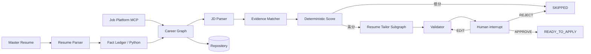
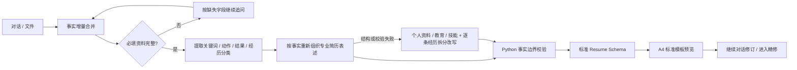

# Career Agent POC

高代码、可追溯的求职 Agent。系统把模型限制在语义任务中，事实边界、引用校验、匹配分数、工作流路由和最终发布均由 Python 确定性控制。

## 已有功能

- Resume Parser：Pydantic structured output，并校验每段来源文本。
- Python Inspector 与 Fact Ledger：不调用模型，生成稳定 `fact_001` 等事实 ID。
- JD Parser、Evidence Matcher、确定性匹配评分。
- Tailor Planner、事实约束 Rewriter、硬规则 Validator、可选语义复核。
- LangGraph Resume 子图和 Career 主图，支持 checkpoint、`APPROVE / REJECT / EDIT` 人工确认。
- SQLAlchemy async repository，POC 使用 SQLite。
- Job Platform MCP：真实 `search_jobs` / `get_job_detail` tools、统一 client、可运行 MockAdapter。
- 猎聘官方 MCP 已接入只读搜索和详情补全；BOSS、智联仍是显式 unavailable/not-implemented 桩。
- OpenAI-compatible structured-output provider，可通过环境变量切换 OpenAI、DeepSeek、Qwen 兼容端点。

## 架构



核心原则：每条定制简历 bullet 必须引用已有且 `CONFIRMED` 的 fact ID；模型不能决定分数、路由或批准状态。

初版简历采用独立的 typed LangGraph 工作流，而不是用一次 Prompt 同时承担理解、改写和排版：



整份结构化输出失败时，系统会自动走拆分路径并仅重试失败的小对象，不再要求用户反复点击
“重新整理”。最终内容始终先进入同一 `Resume` Schema，再由 HTML、Word 和 PDF 渲染器输出；
模型负责语义理解和专业表达，Python 负责必填门控、来源索引、数字与技术事实校验及流程路由。

## 安装与离线 Demo

需要 Python 3.12+：

```powershell
python -m pip install -e .
python -m pytest -q
python examples/demo.py
```

## 本地 Web 前端

确认 `.env` 已配置模型和猎聘 Token 后，在项目根目录运行：

```powershell
python -m pip install -e .
python -m career_agent.web
```

浏览器会自动打开 `http://127.0.0.1:8000`。页面串联候选人建档、初版简历预览、
猎聘实时搜岗、完整 JD、确定性匹配、首页对话修改简历和投递确认流程。
岗位详情页可复制完整 JD，返回首页聊天框粘贴并要求 Agent 按岗位调整简历。
“分析匹配并准备面试”只解析 JD、核对当前简历事实、显示匹配度并准备面试题，
不会在岗位页另生成一份简历。首页对话修改完成后，可回到岗位页重新分析。
投递成功后，如果开启页面上的模拟面试开关，会进入独立面试页。面试题依据岗位 JD
和已确认事实生成；练习回答只保存在当前浏览器，可清空，不会发送到模型或招聘平台。
如果模型在匹配中引用了不存在的事实编号，系统会剔除无依据内容或将该要求标为
“待核实”，再继续计算，不会把它当作匹配证据。

后端始终读取本项目根目录的 `.env`，不依赖终端的当前目录；修改配置后需重启服务。
首页和静态资源带禁用缓存响应头，CSS/JavaScript 地址附带内容版本，刷新即可获取最新界面。
右上角“服务已就绪”表示后端可访问且配置完整；模型和猎聘外部接口是否可用，以实际调用结果为准。
连接短暂中断时，页面会自动重试，也可以点击“重新连接”。

简历生成后直接出现在对话中：点击文字编辑，悬浮工具栏可进行 AI 优化、精简和撤销；
按住大标题上下拖动即可调整整个模块。右上角“精修编辑”打开完整排版工具，左上角
“返回对话框”返回同一份简历。初版简历不再占用左侧的独立流程步骤。

精修编辑的“+ 自定义简历”会在模板栏旁打开小型设计 Agent，可收起和关闭，按住标题栏可以
拖动，输入区和按钮不会触发移动。必须手动选择设计技能后才会调用模型；目前提供本地
`ui-ux-pro-max`。先给出设计方案，回复“确认”或点击“确认并生成模板”后才保存为可反复选用的
预置模板，并显示版式缩略图。可新增多个模板，也可用卡片上的 × 删除单个模板。
预设的“现代”“经典”“侧栏”分别采用极光渐变页眉、暖纸正式排版和深色科技信息栏；点击卡片即可切换，简历内容不变。设计 Agent 新生成的模板也可选择版式与视觉风格（极光、科技网格、暖纸或纯色），并将配色、字体、字号与紧凑度应用到预览和 Word/PDF 导出。上传自己的 Word 模板入口仍保留。Word 版采用可编辑的色块和文字，PDF 版保留装饰图形。
会话和模板保存在本机 `tmp/workspaces.json`，服务重启后可恢复；其中包含简历个人资料，请勿提交。

首次建档不再填写固定表格，而是进入一个对话式 Career Intake Agent。用户可以从“没有简历，
帮我生成”或“已有简历，帮我修改”开始，用自然语言一次提供任意数量的信息。Agent 会持续维护
结构化草稿，并按缺槽结果追问姓名、电话、邮箱、学校、专业、学历、教育时间和技能等基础
资料。用户明确说“不提供”或“跳过这项”时，系统会记录略过的字段，停止追问，生成、确认和
下载时也不会补造这些内容；以后主动提供该项时可以恢复。基础项已提供或明确略过后，再询问工作/实习、项目、科研、竞赛、校园、奖学金、奖项、证书、个人
总结、求职方向、意向 JD 和照片等非必填资料。已经在前文明确提供的主题不会重复询问。可选项
完成或全部跳过后，Agent 会在对话框内直接生成一份 AI 专业整理版预览；用户可以继续聊天补充，
预览会重新生成，确认方向后再进入独立的初版简历精修页。

对话框使用 `Enter` 发送、`Shift+Enter` 换行。Agent 会先对散乱描述做语义分类：明确的校园、
竞赛、科研、课程项目、工作或实习经历直接归档；只有雇主经历确实无法区分正式工作与实习时才
追问。尚未提供、也没有明确略过的基础信息会继续询问；明确拒绝提供的信息不会阻塞下一步。
至少需要一项真实资料、技能或经历才能生成有内容的简历。

对话页使用整个右侧工作区，消息滚动条位于右侧边缘，正文和预览使用更宽的内容列。
欢迎区在聊天开始后保留，输入框位于底部；资料摘要默认折叠，展开后可查看已整理信息。

对话入口支持上传 10MB 以内的 `.docx`、`.pdf`、`.txt`、`.md`、PNG、JPEG 和 WebP。Word/PDF/
文本会提取正文；图片由当前多模态模型自动判断为个人照片、简历文档或其他图片，用户不需要额外
说明图片类型。所有非结构化内容都会先经过语义提取和分类，再进入原有的事实账本与简历生成流程。

照片和文件可直接从文件夹拖入聊天区域；复制图片或截图后，也可在输入框按 `Ctrl+V` 粘贴。
附件先显示在输入框上方，可预览缩略图或删除，点击发送后才交给 Agent 处理。每次最多 5 个文件，
每个不超过 10MB。普通文字粘贴保持原有行为。关于必填资料、可选资料和跳过的通用说明只在首次说明。

生成后进入独立的“初版简历”编辑页，不再挤在建档表单右侧。页面中的姓名、联系方式、学校、
日期、经历描述和技能均可直接点击修改；各模块可拖拽调整顺序。内置现代、经典、极简三种版式，
也可上传 5MB 以内的 `.docx` Word 模板，系统会读取其字体、颜色、字号和页面设置。Word/PDF
下载与当前模板、模块顺序及编辑内容一致。只有点击“确认并发现岗位”后，当前可见版本才会成为
事实账本的确认来源并开放岗位搜索；切换回原始输入版后也可编辑和确认。编辑页下方的简历
Agent 可以通过自然语言补充真实信息、纠正日期、删除内容或改写表达，结果会直接回写到简历。
首页对话改写完成后可在简历编辑页下载 Word/PDF，再到猎聘人工更新投递附件。
栏目拖拽采用经过即换位的实时排序，不需要把鼠标精确放到某个投放点。WebP 等上传照片会在
导出时安全转换为 PNG，真实简历中的非法控制字符也会在 Word/PDF 渲染前清理。

如不希望自动打开浏览器：

```powershell
python -m career_agent.web --no-browser
```

Demo 默认自动批准，完全离线，不使用模型 key。人工逐个确认：

```powershell
python examples/demo.py --decision interactive
```

输出会显示岗位、确定性匹配度、证据差距、改写 bullet 及其 `facts=['fact_...']`，最后显示 `READY_TO_APPLY` 或 `SKIPPED`。系统不会自动投递。

## 绑定模型密钥并挨个测试

先复制配置模板，切勿提交真实密钥：

```powershell
Copy-Item .env.example .env
```

在 `.env` 中至少填写：

```dotenv
CAREER_AGENT_LLM_API_KEY=你的密钥
CAREER_AGENT_LLM_MODEL=你的模型名
CAREER_AGENT_LLM_BASE_URL=
```

官方 OpenAI 端点将 `BASE_URL` 留空。DeepSeek、Qwen 的兼容端点示例已写在 `.env.example`。所选模型必须支持兼容的 JSON Schema structured output；不支持时会明确失败，不会退回自由文本解析。

按阶段测试，每条命令只运行到指定阶段：

```powershell
python examples/provider_smoke.py --step resume
python examples/provider_smoke.py --step jd
python examples/provider_smoke.py --step evidence
python examples/provider_smoke.py --step plan
python examples/provider_smoke.py --step rewrite
python examples/provider_smoke.py --step semantic
```

一次跑完整链路：

```powershell
python examples/provider_smoke.py --step all
```

每次调用会真实消耗所配置模型的额度。Provider 不记录 API key、完整 prompt、简历全文或模型完整响应。

## MCP 使用

业务层使用 `MCPJobPlatformClient`，不导入具体平台 adapter。POC 测试和 Demo 采用官方 SDK 的进程内 MCP 连接，无需启动端口。也可把远程 MCP URL 传给同一 client：

```python
from career_agent import MCPJobPlatformClient

job_source = MCPJobPlatformClient("http://localhost:8000/mcp")
```

Mock 数据覆盖 Python Agent、数据分析、Java 负责人三类岗位。真实平台没有授权 endpoint 时抛出明确错误，不抓取受保护页面，也不处理登录、验证码或风控绕过。

## 候选人首次建档与公开企业 ATS

`CandidateIntakeDraft` 用于前端首次建档。`validation_issues()` 返回需要标红的必填字段；
资料完整后，`build_resume()` 生成可进入 Fact Ledger 的基础简历。课程、项目和头像均为选填；
没有填写的选填模块不会被虚构。`render_resume_html()` 提供安全的基础 HTML 预览。

公开企业岗位支持服务端 `GreenhouseAdapter`、`LeverAdapter` 和
`SmartRecruitersAdapter`。Adapter 接收“公司显示名 → ATS slug”配置，统一返回完整 JD、
来源地址及 `apply_url`，不执行自动投递。例如搜索 HoYoverse 的公开岗位：

```powershell
python examples/public_job_search.py --provider smartrecruiters --company HoYoverse --slug HoYoverse --keyword Engineer
```

也可以叠加 JD 偏好：

```powershell
python examples/public_job_search.py --provider smartrecruiters --company HoYoverse --slug HoYoverse --keyword Programmer --preference AI
```

公司规模、行业等字段只有在上游 ATS 明确提供或产品配置表中已有可信数据时才参与筛选，
不会让模型猜测。岗位语义匹配继续由 JD Parser → Evidence Matcher 完成，最终分数仍由 Python
确定性计算。

## 内置 MCP、外部 MCP 与猎聘

`JobPlatformRegistry` + `create_job_platform_server()` 是本项目自研 MCP Server。
`ExternalMCPAdapter` 用于接入第三方 MCP Server：工具名称、请求参数和响应转换均可配置，
第三方契约不需要伪装成本项目的固定 Schema。默认约定为 `search_jobs`、`get_job_detail`，
也可以映射成其它名称：

```python
adapter = ExternalMCPAdapter(
    platform="partner",
    target="https://partner.example/mcp",
    search_tool="find_positions",
    detail_tool="read_position",
    build_search_arguments=lambda query: {
        "q": query.keyword,
        "location": query.city,
    },
    normalize_search=partner_search_normalizer,
    normalize_detail=partner_detail_normalizer,
)
```

自研 Adapter、公开 ATS Adapter 和外部 MCP Adapter 可以同时注册：

```python
registry = JobPlatformRegistry(
    [MockAdapter(), GreenhouseAdapter({...}), ExternalMCPAdapter(...)]
)
```

### 猎聘官方远程 MCP

`vendor/liepin-job-mcp` 保存了猎聘官方 MCP 配置仓库。实际 Server 是托管服务，项目不会在
本机启动一份猎聘服务。`LiepinMCPAdapter` 使用 streamable HTTP 连接当前 README 公布的
`https://open-agent.liepin.com/mcp/user`，只允许调用只读工具 `user-search-job`，不会暴露
`user-apply-job` 或修改猎聘简历的工具。

在猎聘 MCP 页面生成授权 Key 后，只写入本地 `.env`：

```env
LIEPIN_MCP_URL=https://open-agent.liepin.com/mcp/user
LIEPIN_MCP_USER_TOKEN=你的授权Key
```

不要将真实 Token 提交到 Git 或发送到聊天。只读搜索示例：

```powershell
python examples/liepin_mcp_search.py --keyword "Agent工程师" --city "上海"
```

猎聘职位工具返回岗位摘要和官方 `jobDetailUrl`，不会直接在 MCP 响应中附带完整 JD。
需要完整岗位职责时，加上 `--details`；Adapter 会只读访问该公开详情页，从标准
`JobPosting` JSON-LD 提取 JD，并将 `detail_verified` 标记为 `True`：

```powershell
python examples/liepin_mcp_search.py --keyword "Agent工程师" --city "上海" --details --limit 3
```

详情 URL 同时作为用户最终查看和投递的跳转路径；系统不会调用 `user-apply-job`。

如果需要保留 CLI 作为故障降级，可组合为：

```python
liepin = FallbackJobPlatformAdapter(
    [
        LiepinMCPAdapter.from_env(),
        LiepinCLIAdapter(
            "vendor/liepin-cil",
            python_executable="vendor/liepin-cil/.venv/Scripts/python.exe",
        ),
    ]
)
registry = JobPlatformRegistry([liepin, GreenhouseAdapter({...})])
```

系统优先调用官方 MCP；只有 MCP 连接或授权不可用时才调用 CLI。不会为了合并结果重复请求两边，
避免浪费猎聘每分钟共享调用配额。

### 猎聘 CLI 备用通道

猎聘 CLI 需要从[官方仓库](https://github.com/liepin-tech-2026/liepin-cil)单独下载到
`vendor/liepin-cil`；本仓库不再分发第三方源码。该项目实际提供的是
CLI + Agent Skill，而不是 MCP 协议 Server；它调用路径名为 `/mcp/search-job` 的猎聘 HTTP
接口，但本地没有 MCP Server transport。因此本项目使用只读 `LiepinCLIAdapter` 调用
`job search --output json`，没有接入 `job apply`。

首次使用时为它创建独立虚拟环境，避免污染 Career Agent 依赖：

```powershell
git clone https://github.com/liepin-tech-2026/liepin-cil vendor/liepin-cil
cd vendor\liepin-cil
python -m venv .venv
.\.venv\Scripts\python.exe -m pip install -e .
.\.venv\Scripts\python.exe -m liepin_cli.main setup
```

构建 `deploy/Dockerfile` 或运行 `deploy/package.py` 前，也需先将该官方仓库克隆到上述路径。

`setup` 必须由用户在交互终端完成，不要把 token 发到聊天或写入源码。完成后可验证：

```powershell
.\.venv\Scripts\python.exe -m liepin_cli.main job search --job-name "Python开发" --address "上海" --page 0 --output json
```

应用中连接该独立环境：

```python
adapter = LiepinCLIAdapter(
    "vendor/liepin-cil",
    python_executable="vendor/liepin-cil/.venv/Scripts/python.exe",
)
```

猎聘 CLI 当前没有岗位详情命令。只有搜索响应确实包含完整职责/要求时，岗位才会标记为
`detail_verified=True` 并进入 JD 定制流程；否则不会拿搜索摘要冒充完整 JD。

## 目录

```text
career_agent/
  agent/          Career 主图与状态
  resume/         解析、事实、改写、验证和 Tailor 子图
  jd/             JD 模型与解析
  jobs/           岗位模型和确定性评分
  job_platform/   adapters、MCP server、统一 client
  llm/            provider 协议与 OpenAI-compatible 实现
  persistence/    SQLAlchemy repository
examples/
  demo.py
  provider_smoke.py
tests/
```

两个低代码导出包只作为业务规则来源，运行时不依赖它们。迁移取舍见 `LEGACY_MIGRATION_AUDIT.md`。
